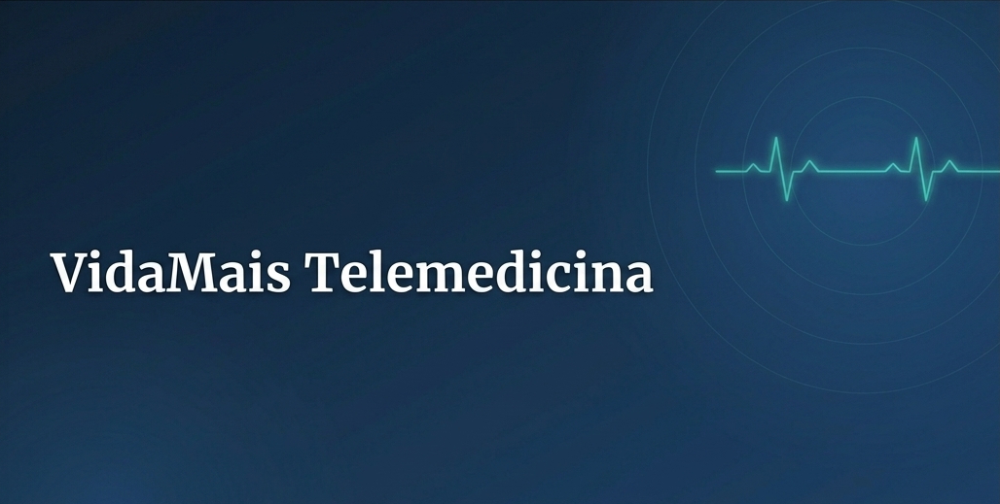
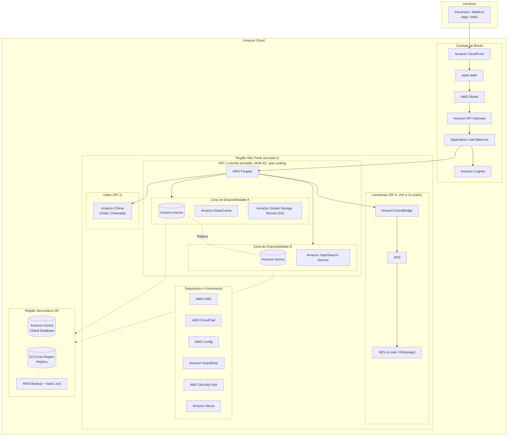

  

  
  
  

## Sumário

- [Sumário](#sumário)
- [Sobre o projeto](#sobre-o-projeto)
- [Problema](#problema)
- [Solução](#solução)
- [Antes x Depois](#antes-x-depois)
- [Arquitetura Proposta](#arquitetura-proposta)
- [Escopo do MVP](#escopo-do-mvp)
- [Requisitos Não-Funcionais](#requisitos-não-funcionais)
- [Tecnologias Utilizadas](#tecnologias-utilizadas)
- [Integrantes do Grupo](#integrantes-do-grupo)

## Sobre o projeto

Este projeto é o Trabalho de Conclusão de Curso (TCC) do programa **AWS re/Start**, referente ao **Case VidaMais Telemedicina**. 

A rede de clínicas VidaMais oferece consultas médicas por videochamada e mantém o prontuário eletrônico dos pacientes. O objetivo deste trabalho é propor a modernização da sua arquitetura legada, migrando-a para a nuvem da AWS. 

Com isso, pretende-se centralizar o prontuário eletrônico para todas as unidades, garantindo maior disponibilidade, resiliência, segurança e total conformidade com a Lei Geral de Proteção de Dados (**LGPD**).

## Problema

Atualmente, a estrutura da VidaMais apresenta diversas fragilidades que comprometem tanto o atendimento, quanto a segurança dos dados dos pacientes: 

- **Prontuários isolados:** Cada clínica possui seu próprio sistema de prontuário eletrônico local, sem integração entre as unidades da rede.
- **Ponto único de falha:** Apenas um servidor físico por clínica, sem redundância. Caso ele falhe, o acesso ao histórico dos pacientes daquela unidade é perdido.
- **Backup inadequado:** Os backups são realizados manualmente em fita magnética, apenas uma vez por semana, representando um alto risco de perda de dados.
- **Dificuldade em situações de urgência:** A falta de integração dificulta o acesso rápido ao histórico médico em momentos críticos.
- **Dados sensíveis em risco:** A arquitetura atual não atende aos requisitos de controle de acesso, criptografia e proteção exigidos para dados de saúde pela LGPD.

## Solução

A proposta consiste em migrar toda a estrutura para a nuvem da AWS, criando um **prontuário eletrônico centralizado, seguro e sempre disponível** para toda a rede de clínicas. 

Dessa forma, busca-se: 

- **Unificação dos dados:** Histórico médico acessível para qualquer profissional autorizado, em qualquer unidade da rede.
- **Alta disponibilidade:** Utilização de serviços gerenciados e arquitetura Multi-AZ para garantir o funcionamento, mesmo em caso de falha.
- **Segurança reforçada:** Controle de acesso rigoroso, autenticação com MFA, criptografia em repouso e em trânsito, em conformidade com a LGPD.
- **Backup automatizado:** Substituição das fitas magnéticas por backups automatizados, com cópia isolada e retenção imutável.
- **Agilidade em urgências:** Acesso imediato ao prontuário em situações críticas.
- **Experiência completa ao paciente:** Agendamento, atendimento por videochamada, emissão digital de receitas e atestados e lembretes automáticos.

## Antes x Depois

| Aspecto | **Antes (Arquitetura Legada)** | **Depois (Proposta na AWS)** |
| :------- | :---------------------------- | :-------------------------- |
| **Prontuário** | Isolado por clínica, sem integração entre unidades. | Centralizado e unificado para toda a rede. |
| **Disponibilidade** | Servidor físico único por clínica (ponto único de falha). | Arquitetura Multi-AZ com serviços gerenciados da AWS. |
| **Backup** | Manual, em fita magnética, apenas uma vez por semana. | Automatizado, com cópia isolada e retenção imutável. |
| **Acesso em urgência** | Limitado à clínica onde o paciente foi atendido. | Acesso rápido ao histórico para profissionais autorizados em qualquer unidade. |
| **Recuperação de Desastres** | Sem metas definidas. | **RPO** < 1 minuto \| **RTO** entre 30 e 60 minutos. |
| **Segurança** | Controles limitados, sem padronização. | Controle de acesso, MFA, criptografia e conformidade com a LGPD. |

## Arquitetura Proposta

  <em>Figura 1 - Arquitetura proposta para a centralização do prontuário eletrônico na AWS</em>

| Serviço AWS | Finalidade |
| :----------- | :----------- |
| **Amazon Aurora PostgreSQL (Multi-AZ)** | Banco de dados centralizado e resiliente para o prontuário eletrônico. |
| **Amazon ECS com AWS Fargate** | Execução da aplicação de telemedicina de forma escalável e gerenciada. |
| **Amazon Cognito** | Autenticação, autorização e aplicação de Autenticação Multifator (MFA). |
| **AWS KMS** | Gerenciamento de chaves para criptografia em repouso e em trânsito. |
| **Amazon S3** | Armazenamento seguro de documentos digitais (receitas, atestados e outros arquivos). |
| **Amazon Chime SDK / WebRTC** | Realização de consultas médicas por videochamada. |
| **Amazon EventBridge Scheduler** | Agendamento automatizado dos lembretes de consulta. |
| **Amazon SNS / Amazon SES** | Envio de notificações e lembretes via SMS, e-mail ou outros canais. |
| **AWS WAF** | Proteção da aplicação contra ataques na camada de borda. |

**Região utilizada:** `sa-east-1` (São Paulo)

## Escopo do MVP

O escopo da primeira versão (MVP) contempla os seguintes requisitos funcionais: 

- [x] **RF-01** - Agendar consulta e realizar atendimento por videochamada.
- [x] **RF-02** - Acessar e atualizar o prontuário eletrônico do paciente durante o atendimento.
- [x] **RF-03** - Emitir receita e atestado digitalmente ao final da consulta.
- [x] **RF-04** - Disponibilizar o histórico médico do paciente para qualquer profissional autorizado da rede.
- [x] **RF-05** - Enviar lembrete automático de consulta ao paciente antes do horário marcado.

## Requisitos Não-Funcionais

| Requisito | Descrição |
| :---------- | :----------- |
| **RNF-01 - Segurança e Conformidade** | Dados de saúde sensíveis, exigindo controle de acesso rigoroso, autenticação com MFA, criptografia e conformidade com a LGPD. |
| **RNF-02 - Disponibilidade** | O prontuário deve estar disponível a qualquer momento, inclusive em situações de urgência. |
| **RNF-03 - Desempenho** | A videochamada deve possuir boa qualidade de conexão e baixa latência. |
| **RNF-04 - Retenção** | O prontuário eletrônico deve ser mantido por muitos anos, conforme exigência legal. |
| **RNF-07 - Recuperação** | Metas estabelecidas para o projeto: **RPO < 1 minuto** e **RTO entre 30 e 60 minutos**. 

## Tecnologias Utilizadas

| Categoria | Tecnologias |
| :----------- | :----------- |
| **Nuvem** | Amazon Web Services (AWS) |
| **Banco de Dados** | Amazon Aurora PostgreSQL (Multi-AZ) |
| **Computação** | Amazon ECS com AWS Fargate |
| **Segurança e Identidade** | Amazon Cognito, AWS KMS, AWS WAF |
| **Armazenamento** | Amazon S3 |
| **Comunicação e Notificações** | Amazon Chime SDK, Amazon EventBridge Scheduler, Amazon SNS, Amazon SES |

## Integrantes do Grupo

| Nome | Função no Projeto |
| :---- | :----------------- |
| **Alexandre G.** | Cloud Engineer |
| **Aynoã N.** | Cloud Solutions Architect |
| **Ayra L.** | Cloud Business Analyst |
| **Felipe G.** | Compliance e LGPD em Nuvem |
| **Maria E.** | Cloud Product Owner |
| **Sthefany S.** | Cloud Data Engineer |
| **Wiani A.** | Cloud Security e SRE |